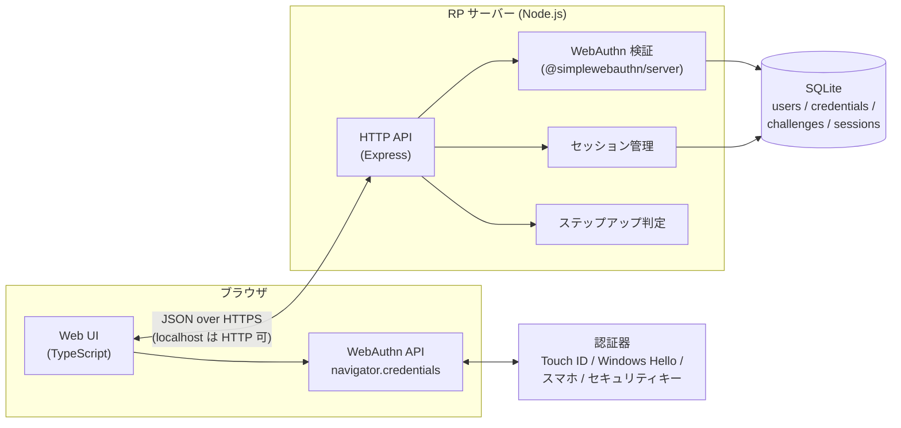
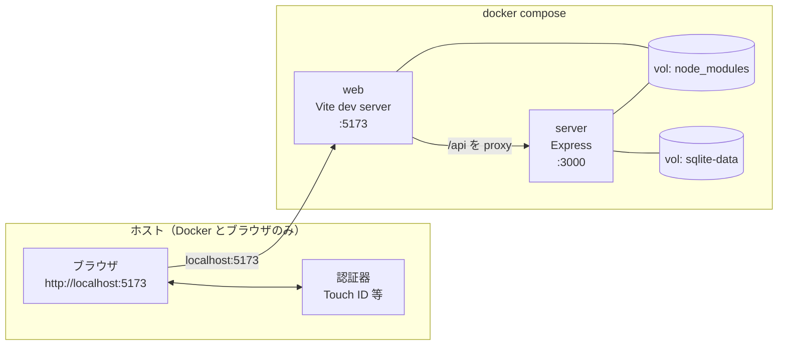
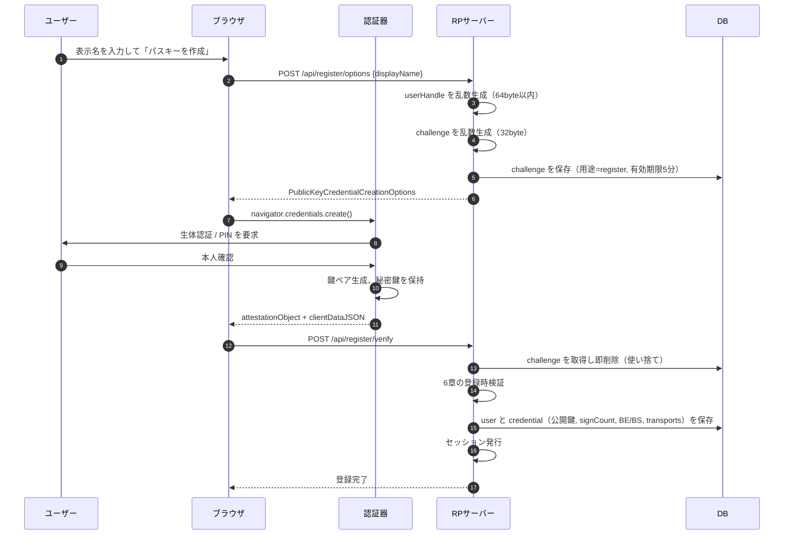
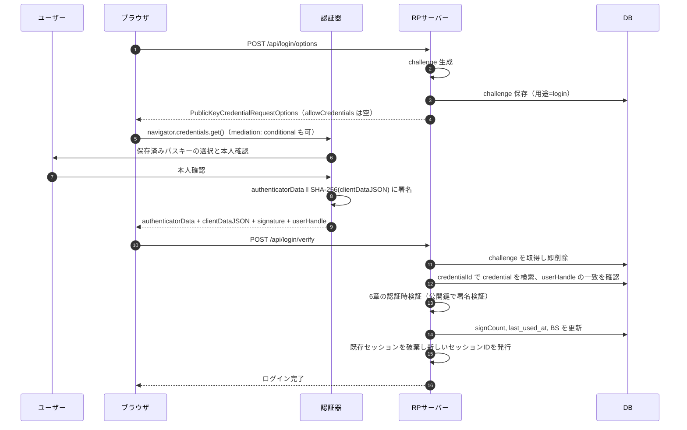
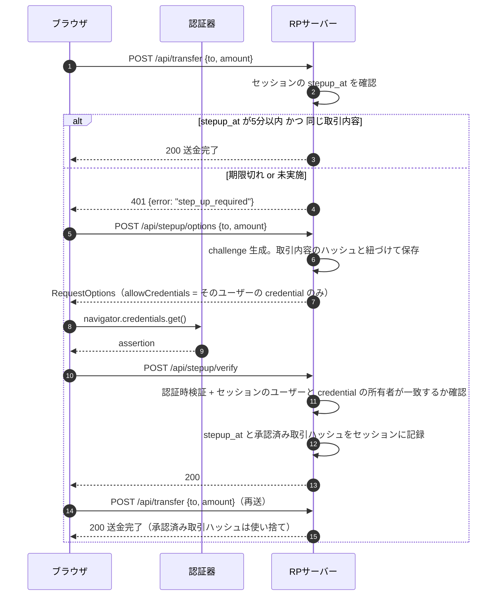
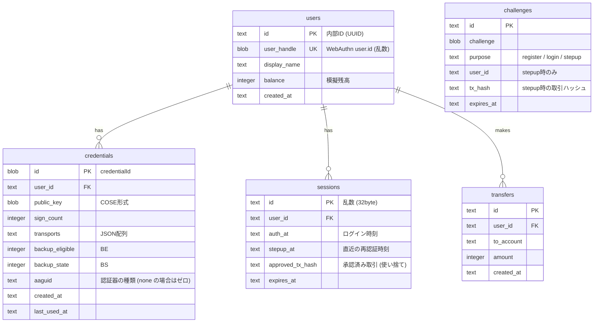

# アーキテクチャ提案書（PoC）: パスキー認証とステップアップ認証

- 作成日: 2026-11-23
- ステータス: 提案（レビュー待ち）
- 前提: [00-background.md](./00-background.md)
- 関連ナレッジ: [02-knowledge-passkey.md](./02-knowledge-passkey.md)

---

## 1. 目的

パスキー（WebAuthn）による登録・ログインと、高リスク操作前のステップアップ認証を最小構成で実装し、仕組みを理解する。

成功の定義は次の3点とする。

1. パスキーの登録・ユーザー名なしログインがブラウザで動く
2. サーバー側の検証項目をすべて自前のテストで確認でき、どれか一つを外すと攻撃が通ることを再現できる
3. ログイン済みでも「送金」操作の直前にパスキー再認証を要求でき、古いセッションだけでは送金できない

## 2. スコープ

### 対象

| 区分 | 内容 |
|---|---|
| 登録 | 新規ユーザー作成とパスキー登録、既存ユーザーへの2本目のパスキー追加 |
| 認証 | discoverable credential によるユーザー名なしログイン、Conditional UI（入力欄のオートフィル） |
| ステップアップ | 模擬「送金」API の直前にパスキー再認証を要求する |
| セッション | サーバー側セッション、ログイン時のID再発行、認証時刻の保持 |
| 可視化 | clientDataJSON、authenticatorData のフラグ、signCount などを画面とログに出す |
| 攻撃再現 | origin 改ざん、challenge 再利用、UVなし、別RP IDの鍵、などをテストで再現する |

### 対象外

- 本番運用（冗長化、監視、レート制限の作り込み）
- attestation による認証器の機種検証（`attestation: "none"` で進める）
- アカウント復旧フロー（設計上の論点として 9章に記載するのみ）
- パスワード認証との併用・移行
- ネイティブアプリ（iOS / Android）からの利用

## 3. 用語

| 用語 | 意味 |
|---|---|
| RP（Relying Party） | 認証を受け入れる側のサービス。本PoCのサーバー |
| RP ID | 鍵を紐づけるドメイン。PoCでは `localhost` |
| 認証器（Authenticator） | 秘密鍵を保持し署名する主体。端末内蔵（Touch ID、Windows Hello）、スマホ、セキュリティキーなど |
| パスキー | discoverable credential（認証器内にユーザー情報も保存される鍵）の通称。同期型と端末固定型がある |
| Attestation | 登録時に認証器が返すデータ。公開鍵を含む |
| Assertion | 認証時に認証器が返す署名 |
| UP / UV | authenticatorData のフラグ。UP はユーザーが居た（タップ等）、UV は本人確認した（生体・PIN） |
| BE / BS | Backup Eligible / Backup State。同期可能な鍵か、現在同期されているか |
| userHandle | RP がユーザーに割り当てる不透明なID（`user.id`）。メールアドレス等の個人情報は入れない |

## 4. 全体構成



### 技術選定

| 層 | 採用 | 理由 |
|---|---|---|
| 言語 | TypeScript（ESM、サーバー・クライアント共通） | 型でWebAuthnの構造体を追いやすい。AIの学習量が多く、型エラーがAIへのフィードバックになる |
| 実行 | Node.js LTS + `tsx` | ビルドなしで `.ts` を直接実行でき、試行錯誤が速い |
| サーバー | Express 5 | AIの学習量が最も多く、情報も豊富 |
| スキーマ | zod | APIの入出力・設定・DB行を zod で定義し、型とランタイム検証を1か所にまとめる。AIが仕様を読む起点にもなる |
| WebAuthn | `@simplewebauthn/server` / `@simplewebauthn/browser` | 実績がありCBOR・COSEのパースを任せられる。検証ロジックは学習用に自前の確認テストも書く |
| DB | SQLite（`node:sqlite`。使えなければ better-sqlite3） | ファイル1つで完結し、中身を直接覗ける。Node 組み込みならネイティブビルドが不要 |
| フロント | Vite + 素の TypeScript | フレームワークの知識を前提にしない。画面が増えたら Vue に移行する |
| テスト | Vitest（単体・攻撃再現）、Playwright（E2E） | 15.2 のとおり、仮想認証器でAIが人手なしにE2Eを回せる |
| 品質 | ESLint（typescript-eslint、sonarjs、security）+ Prettier | AIが書いたコードを機械的に検査する。sonarjs で複雑さ、security で危険なパターンを検出する |
| パッケージ管理 | yarn | lockfile で依存を固定する |

| 実行環境 | Docker / Docker Compose | ホストの global 環境を汚さず、壊しても作り直せる |

バージョンは実装開始時点の最新安定版で固定する。Node.js もベースイメージのタグ（例: `node:<LTS>-slim`）で固定する。

### 実行環境（Docker）

試して壊せることを優先し、すべてをコンテナ内で完結させる。ホストに必要なのは Docker とブラウザだけとする。

**方針**

- ホストに Node.js、npm パッケージ、SQLite を入れない。`npm install` もテストもコンテナ内で実行する。
- `node_modules` と SQLite のDBファイルは名前付きボリュームに置き、ホストのディレクトリには作らない。ソースコードだけをバインドマウントしてホットリロードする。
- `docker compose down -v` でDB・依存パッケージごと完全に初期化できる状態を保つ。壊したら消して作り直す、を前提にする。
- ブラウザと認証器（Touch ID 等）はホスト側のものを使う。WebAuthn はブラウザと OS の機能なので、コンテナに入れる必要はない。

**構成**



| サービス | 役割 | 公開ポート | マウント |
|---|---|---|---|
| `web` | Vite 開発サーバー。`/api` を `server` へプロキシ | `127.0.0.1:5173` | `./web`（ソース）、`web_node_modules` |
| `server` | Express API | 公開しない（`web` 経由のみ） | `./server`（ソース）、`server_node_modules`、`sqlite-data` |
| `tunnel`（任意） | ngrok / cloudflared。クロスデバイス認証を試すときだけ `profiles` で起動 | なし | なし |

**WebAuthn との整合**

- ブラウザから見た origin は `http://localhost:5173` になる。コンテナ内部のホスト名（`server` 等）は origin に現れないので、RP ID は `localhost` のままでよい。
- フロントと API を Vite のプロキシで同一オリジンにまとめ、CORS と Cookie の SameSite 問題を避ける。
- ポートは `127.0.0.1` にのみバインドし、LAN 内の他端末からは見えないようにする。
- RP ID・許可 origin は環境変数（`RP_ID`、`RP_ORIGIN`）で渡し、トンネル利用時に切り替えられるようにする。

**基本操作**

| 操作 | コマンド |
|---|---|
| 起動 | `docker compose up -d` |
| ログ確認 | `docker compose logs -f server` |
| テスト | `docker compose run --rm server npm test` |
| DBを覗く | `docker compose exec server sqlite3 /data/app.db` |
| 完全初期化 | `docker compose down -v` |
| クロスデバイス試験 | `docker compose --profile tunnel up -d` |

### 実行環境の制約

- WebAuthn はセキュアコンテキストでしか動かない。`http://localhost` は例外として許可されるので、PoCは `localhost` で動かす。
- RP ID は origin のホスト名と一致するか、その上位ドメインである必要がある。`127.0.0.1` と `localhost` は別物として扱われるので混在させない（ポートのバインド先が `127.0.0.1` でも、ブラウザでは `localhost` で開く）。
- スマホを使ったクロスデバイス認証（QRコード経由）を試す場合は、`tunnel` サービスで HTTPS の公開URLを用意し、`RP_ID` と `RP_ORIGIN` をそのドメインに切り替える。RP ID が変わると既存のパスキーは使えなくなるので、DBも初期化する。

## 5. 処理フロー

### 5.1 登録（Registration / Attestation）



登録オプションの主な値:

| 項目 | 値 | 意図 |
|---|---|---|
| `rp.id` | `localhost` | 鍵を紐づけるドメイン |
| `user.id` | 乱数（base64url） | 個人情報を認証器に保存しない |
| `pubKeyCredParams` | ES256(-7), RS256(-257) | 主要な認証器をカバー |
| `authenticatorSelection.residentKey` | `required` | パスキー（ユーザー名なしログイン）にする |
| `authenticatorSelection.userVerification` | `required` | 生体・PINを必須にする |
| `attestation` | `none` | 機種検証は対象外 |
| `excludeCredentials` | そのユーザーの既存credential | 同じ認証器への二重登録を防ぐ |
| `timeout` | 300000 ms | |

### 5.2 認証（Authentication / Assertion）



`allowCredentials` を空にすることで、ユーザーがIDを入力せずに認証器側のパスキー一覧から選べる。サーバーは返ってきた `userHandle` と `credentialId` からユーザーを特定する。

### 5.3 ステップアップ認証（送金前の再認証）

二次被害対策の中心。ログイン済みセッションを盗まれても、送金にはその場でのパスキー署名が要る状態を作る。



設計上のポイント:

- challenge を取引内容（送金先・金額）に紐づける。承認後に金額を書き換えても通らない。
- 承認は1回の取引にのみ有効で、使ったら消す。
- `allowCredentials` をログイン中ユーザーの鍵に限定し、別人の鍵での承認を拒否する。
- ブラウザ上で改ざんされた画面に騙されて承認するリスクは残る（WebAuthn は取引内容を認証器に表示しない）。この限界は9章に記す。

## 6. サーバー側の検証項目

PoCの学習の中心。ライブラリが内部で行う検証を列挙し、各項目に対して「外すと何が通るか」をテストで再現する。

### 6.1 共通（clientDataJSON）

| # | 検証 | 外した場合に通る攻撃 |
|---|---|---|
| C1 | `type` が `webauthn.create` / `webauthn.get` | 登録用の応答を認証に流用 |
| C2 | `challenge` がサーバー発行の未使用・期限内の値と一致 | リプレイ攻撃（過去の署名の再送） |
| C3 | `origin` が許可リスト（`http://localhost:5173`）と一致 | フィッシングサイト経由の応答を受理 |
| C4 | challenge を検証後すぐ削除する | 同じ challenge での二重ログイン |

### 6.2 authenticatorData

| # | 検証 | 外した場合に通る攻撃 |
|---|---|---|
| A1 | `rpIdHash` が SHA-256(`localhost`) と一致 | 別ドメイン用の鍵による署名を受理 |
| A2 | UP フラグが立っている | ユーザー不在での自動署名 |
| A3 | UV フラグが立っている | 端末を拾った第三者が生体・PINなしで使用 |
| A4 | `signCount` が前回より大きい（両方0なら同期パスキーとして許容） | 複製された認証器の検知漏れ |

### 6.3 登録時のみ

| # | 検証 | 意図 |
|---|---|---|
| R1 | 公開鍵のアルゴリズムが要求した `pubKeyCredParams` に含まれる | 弱いアルゴリズムの混入防止 |
| R2 | `credentialId` が未登録 | 他人の credential の乗っ取り防止 |
| R3 | BE / BS を保存する | 同期型か端末固定型かを後で判断材料にする |

### 6.4 認証時のみ

| # | 検証 | 意図 |
|---|---|---|
| L1 | `credentialId` が登録済み | 未知の鍵の拒否 |
| L2 | 返ってきた `userHandle` と credential の所有者が一致 | credential とユーザーの取り違え防止 |
| L3 | 保存した公開鍵で `authenticatorData ‖ SHA-256(clientDataJSON)` の署名を検証 | 署名偽造の拒否。認証の本体 |

## 7. API 仕様

全API は JSON。認証済み API はセッションCookie（`HttpOnly; SameSite=Lax; Path=/`、HTTPS時は `Secure`）を要求する。状態変更系は `Origin` ヘッダーを検証して CSRF を防ぐ。

| メソッド | パス | 認証 | 説明 |
|---|---|---|---|
| POST | `/api/register/options` | 不要 | 新規ユーザーの登録オプションを返す |
| POST | `/api/register/verify` | 不要 | attestation を検証しユーザーと credential を作成、ログイン状態にする |
| POST | `/api/credentials/options` | 要 | ログイン中ユーザーに追加するパスキーの登録オプション |
| POST | `/api/credentials/verify` | 要 | 追加パスキーを検証・保存 |
| GET | `/api/credentials` | 要 | 登録済みパスキー一覧（作成日、最終利用日、BE/BS、transports） |
| DELETE | `/api/credentials/:id` | 要 + ステップアップ | パスキー削除。最後の1本は削除不可 |
| POST | `/api/login/options` | 不要 | 認証オプションを返す |
| POST | `/api/login/verify` | 不要 | assertion を検証しセッションを発行 |
| POST | `/api/logout` | 要 | セッション破棄 |
| GET | `/api/me` | 要 | ユーザー情報と `auth_at` / `stepup_at` |
| POST | `/api/stepup/options` | 要 | 取引内容に紐づく再認証オプション |
| POST | `/api/stepup/verify` | 要 | 再認証を検証しセッションに承認を記録 |
| POST | `/api/transfer` | 要 + ステップアップ | 模擬送金。残高を減らし履歴を記録する |
| GET | `/api/debug/last-ceremony` | 開発時のみ | 直近の登録・認証のデコード結果を返す（学習用の可視化） |

エラー応答は `{ "error": "<code>", "detail": "<人間向け説明>" }` に統一する。主なコードは `invalid_challenge`、`invalid_origin`、`user_verification_required`、`unknown_credential`、`signature_invalid`、`step_up_required`。

## 8. データモデル



challenge は登録・認証前のためユーザーと紐づかないことが多く、セッションではなくDBに置いて使い捨てを保証する。期限切れの行は起動時と定期的に削除する。

### セッション方針

| 項目 | 値 |
|---|---|
| 方式 | サーバー側セッション（JWTは使わない。即時失効を確実にするため） |
| ID再発行 | ログイン時とステップアップ時に再発行（セッション固定攻撃対策） |
| アイドル期限 | 30分 |
| 絶対期限 | 8時間 |
| ステップアップ有効期間 | 5分、かつ承認した1取引のみ |

## 9. 脅威モデルと限界

| 脅威 | PoCでの対策 | 残るリスク |
|---|---|---|
| フィッシング（AiTM含む） | origin / rpIdHash 検証（C3, A1） | なし（WebAuthnの構造で防がれる） |
| リプレイ | challenge の使い捨て（C2, C4） | なし |
| サーバーDB漏洩 | 公開鍵しか持たない | セッションIDが漏れると有効期間中は悪用される |
| 盗まれたセッションでの送金 | ステップアップ必須 | ステップアップ有効期間（5分）内の窃取 |
| 承認後の取引改ざん | challenge を取引ハッシュに紐づけ | なし |
| 画面改ざんによる誤承認（Man-in-the-Browser） | 対象外 | 認証器は取引内容を表示しないため残る。本番では別経路での通知・確認が必要 |
| 端末の乗っ取り | UV必須（A3） | ロック解除済み端末を操作される場合は防げない |
| 同期元（iCloud、Google、1Password 等）の乗っ取り、またはロック解除中の端末へのマルウェア | BE/BS と AAGUID を記録し可視化 | 防げない。保管庫が開かれれば秘密鍵も使われる。高リスク用途では端末固定鍵（BE=0）の要求を検討 |
| アカウント復旧の悪用 | 対象外（複数パスキー登録を促すのみ） | 本番では復旧経路が最弱点になる。設計の要検討事項 |

## 10. ディレクトリ構成（予定）

```
try-pass-key/
├── CLAUDE.md                   # AI向けの入口。構成、コマンド、守るべき不変条件
├── compose.yaml                # web / server / tunnel(任意) とボリューム定義
├── .env.example                # RP_ID, RP_ORIGIN など
├── docs/
│   ├── 00-background.md
│   ├── 01-architecture-proposal-poc.md
│   ├── 02-knowledge-passkey.md
│   ├── decisions.md            # 判断の記録
│   └── worklog/                # 日ごとの作業ログ
├── plans/                      # マイルストーンごとの実装計画（AIに渡す単位）
├── prompts/                    # AIに渡すプロンプトの雛形（実装、レビュー、攻撃再現）
├── shared/
│   └── schema.ts               # zod スキーマ。API の入出力を server と web で共有
├── e2e/                        # Playwright + 仮想認証器
├── server/
│   ├── Dockerfile
│   ├── src/
│   │   ├── index.ts            # Express アプリ起動
│   │   ├── config.ts           # RP ID, origin, 期限値
│   │   ├── db.ts               # SQLite 接続とスキーマ
│   │   ├── routes/
│   │   │   ├── register.ts
│   │   │   ├── login.ts
│   │   │   ├── credentials.ts
│   │   │   ├── stepup.ts
│   │   │   └── transfer.ts
│   │   ├── webauthn/           # options生成、検証、デバッグ用デコード
│   │   └── session/            # セッション、ステップアップ判定ミドルウェア
│   └── test/
│       ├── verify.test.ts      # 6章の各検証項目
│       └── attacks.test.ts     # 攻撃再現（改ざんした応答を投げる）
└── web/
    ├── Dockerfile
    ├── vite.config.ts          # /api を server へプロキシ
    ├── index.html
    └── src/
        ├── main.ts
        ├── register.ts
        ├── login.ts
        ├── transfer.ts
        └── inspector.ts        # clientDataJSON / フラグの可視化
```

攻撃再現テストでは、本物の認証器の代わりにテスト内で鍵ペアを作って署名する「ソフトウェア認証器」を用意する。これにより origin や rpIdHash を自由に改ざんした応答を作れる。

## 11. マイルストーン

| # | 内容 | 完了条件 |
|---|---|---|
| M1 | 骨組み | `docker compose up` だけでサーバーとフロントが起動し、SQLite のスキーマが作成される。ホストに `node_modules` やDBファイルが作られない |
| M2 | 登録 | ブラウザでパスキーを作成し、credentials テーブルに公開鍵が入る |
| M3 | ログイン | ユーザー名なしでログインでき、`/api/me` が返る。Conditional UI も動く |
| M4 | 可視化 | 直近の ceremony の clientDataJSON、フラグ、signCount を画面に表示できる |
| M5 | 検証テスト | 6章の全項目に対し、正常系と「外すと通る」異常系のテストがある |
| M6 | ステップアップ | 送金前の再認証が動き、期限切れ・取引改ざん・他人の鍵が拒否される |
| M7 | 複数パスキー | 2本目の追加、一覧、削除（ステップアップ付き）ができる |
| M8 | 振り返り | 学んだこと、9章の残リスクへの考察を docs/ にまとめる |

## 12. 受け入れ基準

- [ ] ホストに Docker 以外をインストールせずに、起動・テスト・初期化ができる
- [ ] `docker compose down -v` の後に `up` すると、ユーザー0件のまっさらな状態に戻る
- [ ] Chrome と Safari の両方で、登録とユーザー名なしログインが成功する
- [ ] 6章の C1〜C4、A1〜A4、R1〜R3、L1〜L3 のそれぞれにテストがあり、すべて通る
- [ ] origin を改ざんした assertion、使用済み challenge の再送、UV=0 の assertion が拒否されることをテストで示せる
- [ ] ログイン済みでもステップアップなしの送金が `step_up_required` で拒否される
- [ ] ステップアップ後に金額を変えた送金が拒否される
- [ ] ログイン時にセッションIDが変わる
- [ ] パスキーで防げる脅威と防げない脅威を、9章の表を使って説明できる

## 13. 未決事項

| # | 論点 | 現時点の案 |
|---|---|---|
| Q1 | クロスデバイス認証（スマホでQR）を試すか | M7以降の任意課題。ngrok で HTTPS 化して試す |
| Q2 | 検証ロジックをライブラリに頼らず自作する範囲 | まずライブラリで動かし、M5 で署名検証（L3）と rpIdHash（A1）だけ自作版と比較する |
| Q3 | ステップアップ有効期間 | 5分で開始し、体験してから調整する |
| Q4 | 端末固定鍵（BE=0）を高リスク操作で必須にするか | PoCでは記録・表示のみ。考察を M8 にまとめる |
| Q5 | 別方式（02 の3章）をどれから試すか | M8 の振り返りで、パスキーで残ったリスクに効くものから選ぶ |

## 14. 別方式PoCへの拡張

パスキー以外の方式（DPoP / DBSC、端末固定のセキュリティキー、mTLS など）を試す場合は、本PoCとは別ディレクトリ（`poc-<方式名>/`）に Docker で独立して構築し、互いに影響しないようにする。候補と比較は [02-knowledge-passkey.md](./02-knowledge-passkey.md) の3章にまとめた。

## 15. AI駆動開発の方針

本PoCは AI（Claude Code 等）に実装させる前提で進める。AI が読みやすく、AI が自分で正しさを確かめられる形にする。

### 15.1 AI が理解しやすい構成

| 方針 | 具体策 |
|---|---|
| 仕様を型とスキーマに寄せる | API の入出力・設定・DB行を `shared/schema.ts` の zod で定義する。AI は文章より型を正確に読む |
| 入口を1つにする | `CLAUDE.md` に構成、コマンド（すべて `docker compose` 経由）、6章の検証項目を「消してはいけない不変条件」として書く |
| 作業単位を明示する | マイルストーンごとに `plans/` に計画を置き、AI にはその単位で渡す |
| プロンプトを資産にする | よく使う指示を `prompts/` に置く。例: 「6章の検証項目を1つ外して、通ってしまう攻撃のテストを書け」 |
| 機械的に検査する | `yarn lint`、`yarn typecheck`、`yarn test` を AI が毎回実行する。コンテナ内で動くので AI が環境を壊してもホストに影響しない |
| 1ファイル1責務 | ルート、検証、セッションを分け、AI が読む範囲を狭くする |

### 15.2 人手なしで回るテスト

パスキーは本来 Touch ID などの操作が要るので、そのままでは AI が自力で動作確認できない。そこで次の2段構えにする。

- **単体・攻撃再現（Vitest）**: テスト内のソフトウェア認証器で署名を作る（10章）。
- **E2E（Playwright）**: Chromium の仮想認証器（CDP の `WebAuthn.addVirtualAuthenticator`）を使い、登録→ログイン→ステップアップ→送金をブラウザ操作として通す。コンテナ内のヘッドレス Chromium で動くので、AI が実装後に自分で回せる。

実機（Touch ID、Safari、スマホ）での確認は人が行い、12章の受け入れ基準でチェックする。

## 16. 懸念点と対策

| # | 懸念 | 影響 | 対策 |
|---|---|---|---|
| K1 | 実機で試すと、`localhost` 用のパスキーが iCloud キーチェーンや Google パスワードマネージャーに残る | 実害はない（`localhost` 以外では使われず、既存のパスキーにも触れない）。一覧が散らかる程度 | 普段の開発は仮想認証器（DevTools / E2E）で行い、実機確認後は不要なパスキーを削除する。表示名にはテスト用の名前を使う。詳細は [02-knowledge-passkey.md](./02-knowledge-passkey.md) の1章 |
| K2 | `docker compose down -v` でDBを消しても、認証器側にはパスキーが残る | 使えないパスキーが一覧に出続け、選ぶと `unknown_credential` になる | 学習項目として扱う。Signal API（`PublicKeyCredential.signalUnknownCredential` など）で認証器に削除を伝える実装を M7 の任意課題にする |
| K3 | RP ID を変えると既存のパスキーがすべて使えなくなる | トンネル利用時に毎回作り直しになる | `.env` で切り替え、切り替え時はDBも初期化する手順を `CLAUDE.md` に書く |
| K4 | AI がテストを通すために検証を緩める | 6章の検証が抜けたまま「動く」状態になる。学習目的が崩れる | 6章の各項目に対応する攻撃再現テストを先に書き（TDD）、`CLAUDE.md` に「攻撃再現テストを消す・skip する変更は禁止」と明記する |
| K5 | `/api/debug/last-ceremony` が他のコードに混ざって残る | 本番に持ち込むと情報漏洩になる | `NODE_ENV=development` のときだけルートを登録する。PoCを本番に流用しない前提も `CLAUDE.md` に書く |
| K6 | macOS の Docker でバインドマウントのファイル監視が遅い・効かない | ホットリロードが不安定になる | Vite と `tsx watch` をポーリングモードで動かす設定を用意する |
| K7 | Safari と Chrome で挙動が違う（Conditional UI、エラーの出方） | Chrome だけで作ると Safari で動かない | 12章の受け入れ基準どおり両方で確認する。差分は M8 の振り返りに記録する |
