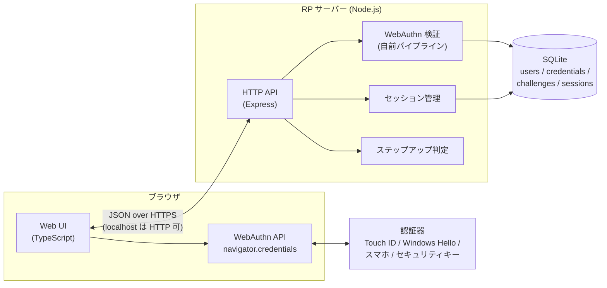
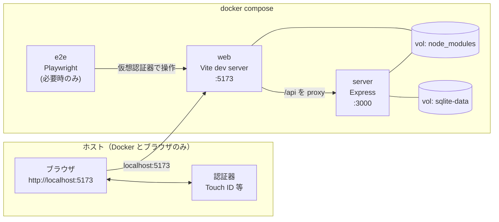
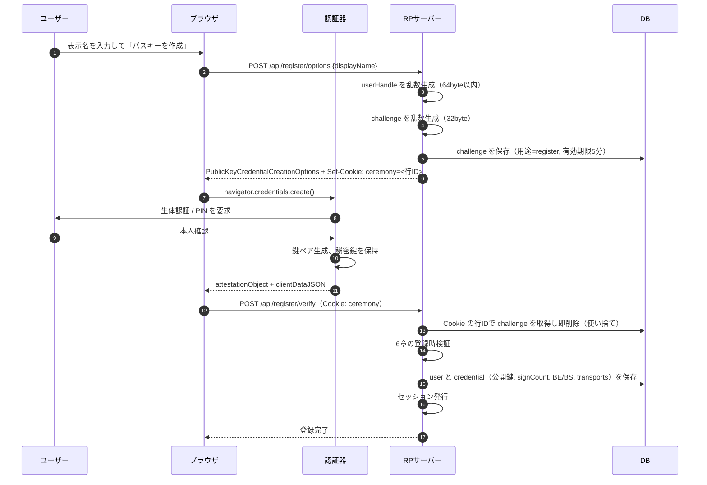
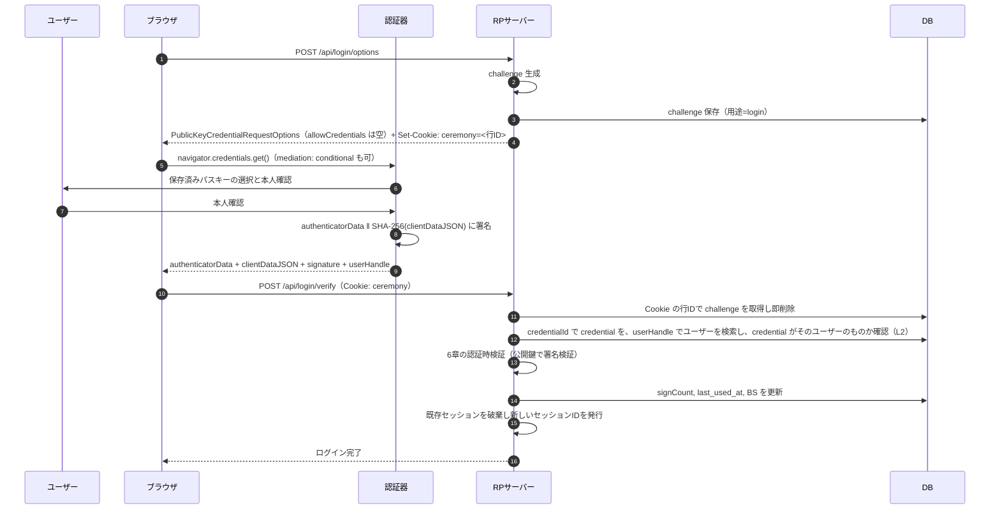
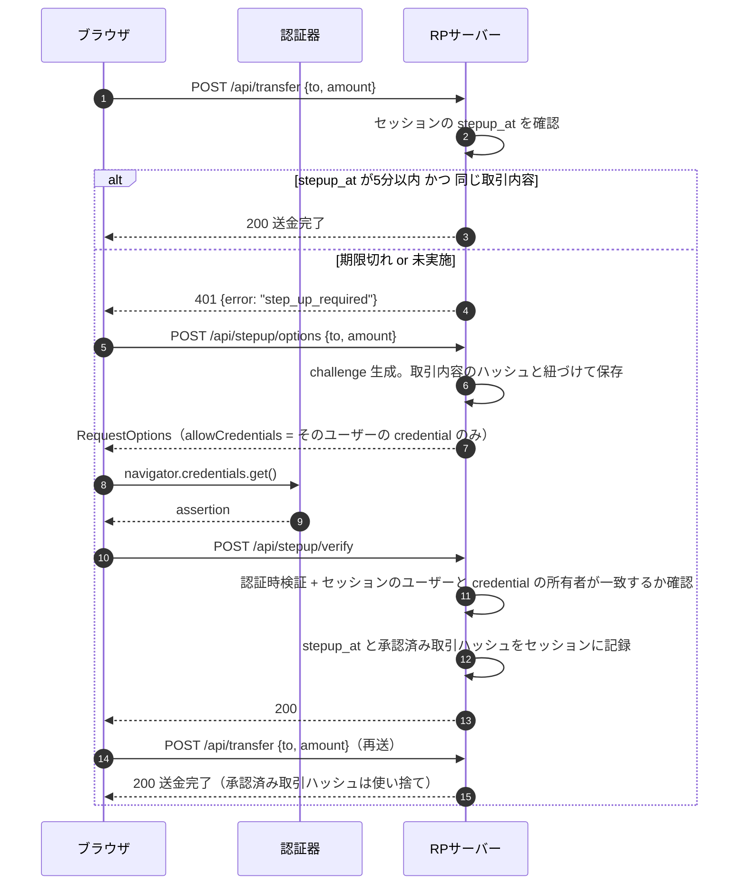
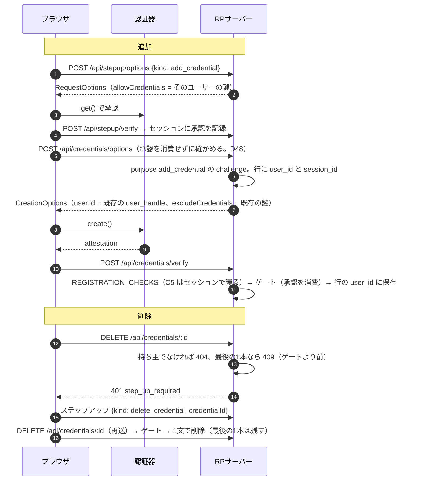
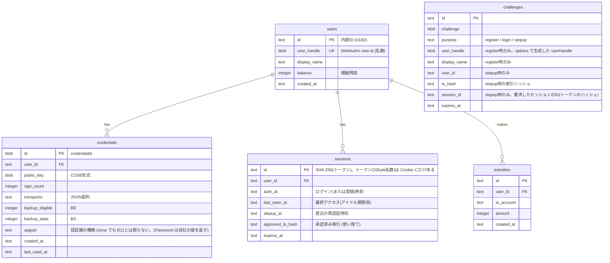

# アーキテクチャ提案書（PoC）: パスキー認証とステップアップ認証

- 作成日: 2026-11-23
- ステータス: 提案（レビュー待ち）
- 前提: [00-background.md](./00-background.md)
- 関連ナレッジ: [02-knowledge-passkey.md](./02-knowledge-passkey.md)

---

## 1. 目的

パスキー（WebAuthn）による登録・ログインと、高リスク操作前のステップアップ認証を最小構成で実装し、仕組みを理解する。

成功の定義は次の3点とする。

1. パスキーの登録・ユーザー名なしログインがブラウザで動く
2. サーバー側の検証項目をすべて自前のテストで確認でき、どれか一つを外すと攻撃が通ることを再現できる
3. ログイン済みでも「送金」操作の直前にパスキー再認証を要求でき、古いセッションだけでは送金できない

## 2. スコープ

### 対象

| 区分 | 内容 |
|---|---|
| 登録 | 新規ユーザー作成とパスキー登録、既存ユーザーへの2本目のパスキー追加 |
| 認証 | discoverable credential によるユーザー名なしログイン、Conditional UI（入力欄のオートフィル） |
| ステップアップ | 模擬「送金」API の直前にパスキー再認証を要求する |
| セッション | サーバー側セッション、ログイン時のID再発行、認証時刻の保持 |
| 可視化 | clientDataJSON、authenticatorData のフラグ、signCount などを画面とログに出す |
| 攻撃再現 | origin 改ざん、challenge 再利用、UVなし、別RP IDの鍵、などをテストで再現する |

### 対象外

- 本番運用（冗長化、監視、レート制限の作り込み）
- attestation による認証器の機種検証（`attestation: "none"` で進める）
- アカウント復旧フロー（設計上の論点として 9章に記載するのみ）
- パスワード認証との併用・移行
- ネイティブアプリ（iOS / Android）からの利用

## 3. 用語

| 用語 | 意味 |
|---|---|
| RP（Relying Party） | 認証を受け入れる側のサービス。本PoCのサーバー |
| RP ID | 鍵を紐づけるドメイン。PoCでは `localhost` |
| 認証器（Authenticator） | 秘密鍵を保持し署名する主体。端末内蔵（Touch ID、Windows Hello）、スマホ、セキュリティキーなど |
| パスキー | discoverable credential（認証器内にユーザー情報も保存される鍵）の通称。同期型と端末固定型がある |
| Attestation | 登録時に認証器が返すデータ。公開鍵を含む |
| Assertion | 認証時に認証器が返す署名 |
| UP / UV | authenticatorData のフラグ。UP はユーザーが居た（タップ等）、UV は本人確認した（生体・PIN） |
| BE / BS | Backup Eligible / Backup State。同期可能な鍵か、現在同期されているか |
| userHandle | RP がユーザーに割り当てる不透明なID（`user.id`）。メールアドレス等の個人情報は入れない |

## 4. 全体構成



### 技術選定

| 層 | 採用 | 理由 |
|---|---|---|
| 言語 | TypeScript（ESM、サーバー・クライアント共通） | 型でWebAuthnの構造体を追いやすい。AIの学習量が多く、型エラーがAIへのフィードバックになる |
| 実行 | Node.js 26（Active LTS）+ `tsx` | ビルドなしで `.ts` を直接実行でき、試行錯誤が速い。`node:sqlite` がフラグなしで使える。Node 25 以降は corepack が同梱されないため、Dockerfile で入れる |
| サーバー | Express 5 | AIの学習量が最も多く、情報も豊富 |
| スキーマ | zod | APIの入出力・設定・DB行を zod で定義し、型とランタイム検証を1か所にまとめる。AIが仕様を読む起点にもなる |
| WebAuthn 検証 | 自前の検証パイプライン（6.0）+ `cbor-x`（CBOR デコードのみ） | 検証を1項目ずつ外して攻撃が通ることを示すには、検証を自分で持つ必要がある。CBOR の文法は学習価値が低いのでライブラリに任せ、authenticatorData の分解・COSE 鍵の変換・各検証は自前で書く |
| WebAuthn 参照実装 | `@simplewebauthn/server`（テストのみ）/ `@simplewebauthn/browser` | サーバー側は本番経路では使わず、同じ入力に対する判定を自前実装と突き合わせる比較用（差分テスト）。ブラウザ側は base64url 変換と Conditional UI の中断処理に使う |
| DB | SQLite（`node:sqlite`。使えなければ better-sqlite3） | ファイル1つで完結し、中身を直接覗ける。Node 組み込みならネイティブビルドが不要 |
| フロント | Vite + 素の TypeScript | フレームワークの知識を前提にしない。画面が増えたら Vue に移行する |
| テスト | Vitest（単体・攻撃再現）、Playwright（E2E） | 15.3 のとおり、仮想認証器でAIが人手なしにE2Eを回せる |
| 品質 | ESLint（typescript-eslint、sonarjs、security）+ Prettier | AIが書いたコードを機械的に検査する。sonarjs で複雑さ、security で危険なパターンを検出する |
| パッケージ管理 | Yarn 4（corepack）の workspaces、`nodeLinker: node-modules` | lockfile で依存を固定する。`server` / `web` / `shared` / `e2e` を1リポジトリで管理し、`shared` の zod を両方から import できる。PnP は AI が `node_modules` を読めずツール相性も悪いため使わない |
| 実行環境 | Docker / Docker Compose | ホストの global 環境を汚さず、壊しても作り直せる |

バージョンは実装開始時点の最新安定版で固定する。Node.js もベースイメージのタグ（`node:26.13.1-slim`）で固定する。例外として TypeScript は 6.0 系にする。7.0（Go 実装）は typescript-eslint が未対応のため（D16）。

### 実行環境（Docker）

試して壊せることを優先し、すべてをコンテナ内で完結させる。ホストに必要なのは Docker とブラウザだけとする。

**方針**

- ホストに Node.js、npm パッケージ、SQLite を入れない。`yarn install` もテストもコンテナ内で実行する。
- リポジトリ全体を `/app` にバインドマウントしてホットリロードする。ルートの `node_modules`（`/app/node_modules`）と SQLite のDBファイルは名前付きボリュームに置き、ホストのディレクトリには作らない。
- 開発用イメージは ルートの `Dockerfile` 1つにし、`deps` / `server` / `web` で共用する。`yarn install` は一回限りの `deps` サービスが行い、`server` と `web` はその完了を待って起動する。共有ボリュームへの同時インストールを避けるため（D17）。E2E だけは `@playwright/test` とバージョンを揃えた Playwright 公式イメージで別サービスにする。
- 依存のバージョン衝突があると、workspace 配下（`server/node_modules` 等）にも `node_modules` が作られ、バインドマウント経由でホストに出てくる。M1 の完了条件で、これが作られていないことを確認する。
- `docker compose down -v` でDB・依存パッケージごと完全に初期化できる状態を保つ。壊したら消して作り直す、を前提にする。
- ブラウザと認証器（Touch ID 等）はホスト側のものを使う。WebAuthn はブラウザと OS の機能なので、コンテナに入れる必要はない。

**構成**



| サービス | 役割 | 公開ポート | マウント |
|---|---|---|---|
| `deps` | `yarn install` を実行して終了する。CI（`CI=true`）では lockfile を書き換えない immutable install になる | なし | `.`（`/app`）、`node_modules`、`yarn_cache` |
| `web` | Vite 開発サーバー。`/api` を `server` へプロキシ | `127.0.0.1:${WEB_PORT:-5173}` | `.`（`/app`）、`node_modules` |
| `server` | Express API | 公開しない（`web` 経由のみ） | `.`（`/app`）、`node_modules`、`sqlite_data` |
| `e2e`（任意） | Playwright のヘッドレス Chromium。`profiles` で必要時のみ起動。`network_mode: service:web` で web と同じネットワークを使い、`http://localhost:<WEB_PORT>` を開く（D29） | なし | `.`（`/app`）、`node_modules`（Node のバージョンが同じで依存は JS のみなので共有） |
| `tunnel`（任意） | ngrok / cloudflared。クロスデバイス認証を試すときだけ `profiles` で起動 | なし | なし |

**WebAuthn との整合**

- ブラウザから見た origin は `http://localhost:5173` になる。コンテナ内部のホスト名（`server` 等）は origin に現れないので、RP ID は `localhost` のままでよい。
- フロントと API を Vite のプロキシで同一オリジンにまとめ、CORS と Cookie の SameSite 問題を避ける。
- ポートは `127.0.0.1` にのみバインドし、LAN 内の他端末からは見えないようにする。
- RP ID・許可 origin は環境変数（`RP_ID`、`RP_ORIGIN`）で渡し、トンネル利用時に切り替えられるようにする。

**基本操作**

| 操作 | コマンド |
|---|---|
| 起動 | `docker compose up -d` |
| ログ確認 | `docker compose logs -f server` |
| 検査（typecheck → lint → test） | `docker compose run --rm server yarn check` |
| E2E | `bash scripts/e2e.sh`（専用のプロジェクト名・ボリューム・ポートで起動し、終わったら消す。開発用の DB を汚さない） |
| DBを覗く | `docker compose exec server sqlite3 /data/app.db`（`sqlite3` CLI は Dockerfile で入れる） |
| 完全初期化 | `docker compose down -v` |
| クロスデバイス試験 | `docker compose --profile tunnel up -d` |

### 実行環境の制約

- WebAuthn はセキュアコンテキストでしか動かない。`http://localhost` は例外として許可されるので、PoCは `localhost` で動かす。
- RP ID は origin のホスト名と一致するか、その上位ドメインである必要がある。`127.0.0.1` と `localhost` は別物として扱われるので混在させない（ポートのバインド先が `127.0.0.1` でも、ブラウザでは `localhost` で開く）。
- スマホを使ったクロスデバイス認証（QRコード経由）を試す場合は、`tunnel` サービスで HTTPS の公開URLを用意し、`RP_ID` と `RP_ORIGIN` をそのドメインに切り替える。RP ID が変わると既存のパスキーは使えなくなるので、DBも初期化する。

## 5. 処理フロー

### 5.1 登録（Registration / Attestation）



登録オプションの主な値:

| 項目 | 値 | 意図 |
|---|---|---|
| `rp.id` | `localhost` | 鍵を紐づけるドメイン |
| `user.id` | 乱数（base64url） | 個人情報を認証器に保存しない |
| `pubKeyCredParams` | ES256(-7), RS256(-257) | 主要な認証器をカバー |
| `authenticatorSelection.residentKey` | `required` | パスキー（ユーザー名なしログイン）にする |
| `authenticatorSelection.userVerification` | `required` | 生体・PINを必須にする |
| `attestation` | `none` | 機種検証は対象外 |
| `excludeCredentials` | そのユーザーの既存credential | 同じ認証器への二重登録を防ぐ |
| `timeout` | 300000 ms | |

### 5.2 認証（Authentication / Assertion）



`allowCredentials` を空にすることで、ユーザーがIDを入力せずに認証器側のパスキー一覧から選べる。サーバーは返ってきた `userHandle` と `credentialId` からユーザーを特定する。

セッションは `userHandle` が指すユーザーに対して発行する。`credentialId` の持ち主ではなく `userHandle` を起点にするのは、仕様の手順どおりであり、L2 を外したときに「攻撃者が自分の鍵で署名し、被害者の `userHandle` を送ると被害者としてログインできる」ことを再現できるため（D28）。

### 5.3 ステップアップ認証（送金前の再認証）

二次被害対策の中心。ログイン済みセッションを盗まれても、送金にはその場でのパスキー署名が要る状態を作る。



設計上のポイント:

- challenge を取引内容（送金先・金額）に紐づける。承認後に金額を書き換えても通らない。
- 承認は1回の取引にのみ有効で、使ったら消す。
- `allowCredentials` をログイン中ユーザーの鍵に限定し、別人の鍵での承認を拒否する。
- ブラウザ上で改ざんされた画面に騙されて承認するリスクは残る（WebAuthn は取引内容を認証器に表示しない）。この限界は9章に記す。

実装の補足（M6、D36〜D39）:

- **取引ハッシュ（M7 から操作ハッシュ）**: `base64url(SHA-256(JSON.stringify({ kind: 'transfer', to, amount })))`。キーはこの順で組み立て直すので、リクエスト本文の書き方に左右されない。`kind` は、別の種類の操作（M7 のパスキー追加・削除）の承認として流用されないようにするため。M7 で `operationHash`（`server/src/operations/operation-hash.ts`）に一般化した。送金のハッシュ値は M6 と同じ（5.4、D42）
- **紐づけ方**: challenge は乱数のまま。options で取引ハッシュを challenge の行（`tx_hash`）に保存し、verify が通ったらセッションの `approved_tx_hash` に写す。challenge に取引を埋め込んでも、認証器が取引を表示しない以上、利用者が何に署名したかの保証は増えない（D37）
- **検証**: verify は `STEPUP_CHECKS` を通す。ログインの検証から L2 を外し、S1（鍵の持ち主がセッションのユーザー）を入れたもの。`allowCredentials` を指定した認証では `userHandle` が返らないことがあり（WebAuthn L3 §5.2.2）、`userHandle` を必須にする L2 では正当な承認が拒否されうる。C5 は一時 Cookie ではなく、行の `session_id` と、応答を送ってきたセッションの ID（トークンのハッシュ）の一致で縛る。ユーザーの一致で縛ると、漏れた応答を同じユーザーの別セッション（盗まれた Cookie）で使えてしまう（D40）
- **セッションIDの再発行**: verify が通ったら、古いセッションを消して新しいIDを発行し、そこに `stepup_at` と `approved_tx_hash` を記録する。`auth_at` と絶対期限は引き継ぐ（ステップアップで延びない）。signCount の記録とセッションの作り直しは1つのトランザクションで行い、途中で失敗したらどちらも残らない
- **送金のゲート**: `/api/transfer` は本文を検証し、セッションの承認を読み込んでから `OPERATION_GATE_CHECKS`（S3 → S2。M6 時点の名前は `TRANSFER_GATE_CHECKS`）を通す。S2 は読み込んだ承認と比べるので、S3 に依存しない。S3 が承認を先に消費するので、S2 で拒否される送金でも承認は使い切りになる。消費は「読んだ値と一致するときだけ消す」条件付き UPDATE で行い、同じ承認で同時に来た2つの送金は片方しか通らない（D38）。残高不足でも承認は戻さない。`/api/stepup/options` が先に残高を確かめるので、普通は起きない

### 5.4 パスキーの追加と削除（M7）

ログイン中のユーザーが、パスキーの一覧を見て、2本目以降を追加し、不要なものを削除する。追加と削除は、どちらもステップアップの承認がなければ通らない（D43）。盗まれたセッションで攻撃者が自分のパスキーを追加できると、Cookie が失効した後もそのパスキーでログインし続けられる。送金よりも被害が長く続く乗っ取りになる。

ステップアップで承認する対象は「操作」で、`transfer` / `add_credential` / `delete_credential` の3種類（`StepupOperation`）。承認は操作ハッシュ（種類ごとにキーの順を固定した `{ kind, ... }` の SHA-256）でセッションに記録し、送金・追加・削除の前に同じゲート `OPERATION_GATE_CHECKS`（S3 → S2）を通す（D42）。



設計上のポイント:

- 承認はセッションに1つだけで、どの操作のステップアップでも上書きされ、どの操作のゲートでも消費される（承認なしの送金や削除を試しただけで、待っていた追加の承認は消える）
- 追加の承認は verify で消費する。作成ダイアログのキャンセルや `excludeCredentials` による拒否の後も、承認が残っていれば options からやり直せる。ゲートは登録の検証がすべて通った後に置き、壊れた応答で承認を消費させない（D44）
- options は、セッションに追加の承認があり、残りが1分以上あるときだけ出す（消費はしない）。なければ 401 `step_up_required` を返し、画面はステップアップしてから取り直す。WebAuthn の `timeout` は承認の残り時間から30秒引いた値にし、承認より先にブラウザの ceremony が終わるようにする。verify で承認切れと分かった時点では、認証器にはもうパスキーができているため（D48）
- 追加の challenge は、ステップアップと同じく要求したセッションに縛る（C5）。追加した鍵は、セッションのユーザーではなく challenge の行の `user_id` に保存する。両者は C5 が通れば一致する。行を起点にすると、C5 を外したときの攻撃（漏れた challenge に攻撃者が自分の鍵で答え、自分の承認済みセッションから送ると、攻撃者の鍵が被害者に付く）をテストで再現できる（D45）
- 追加の options は `user.id` に既存の `user_handle` を使い（追加した鍵でのログインが同じユーザーになる、L2）、`excludeCredentials` に既存の鍵を入れる
- 削除では、持ち主の確認（404 `credential_not_found`）と最後の1本の確認（409 `last_credential`）をゲートより前に行う。他人の鍵を指定したリクエストで承認を消費させないため。この2つは認可と業務ルールで、6章の検証項目ではない（D46）。最後の1本の確認と削除は1文の DELETE にし、同時に2本消しても1本は残る
- 鍵を削除しても、その鍵でログインしたセッションは失効しない（セッションはどの鍵でログインしたかを持たない。9章）
- それでも、複数タブでの同時操作や通信の失敗では、認証器にだけ鍵が残りうる。作成と保存を原子的にする方法がないため（K12、D50）
- 「直近の ceremony」では、追加の検証欄に登録の検証項目に続けてゲート（S3、S2）も並ぶ。ゲートで拒否されたときに、どこで止まったかが行で分かる
- 一覧を読んだときと削除したときに、Signal API（`signalAllAcceptedCredentials`）で受け付ける鍵を認証器に伝える。ログインが L1（未登録の鍵）で拒否されたら `signalUnknownCredential` を呼ぶ。対応ブラウザだけで動き、認証器がどう扱うかは認証器次第（K2）

## 6. サーバー側の検証項目

PoCの学習の中心。ライブラリが内部で行う検証を列挙し、各項目に対して「外すと何が通るか」をテストで再現する。

### 6.0 検証パイプライン（自前実装）

ライブラリの `verify*Response` は全項目を一括で検証するため、1項目だけ外せない。そこで検証を自前で実装し、項目ごとに独立した関数にする。

```ts
// 各検証は ID（C1, A3 など）を持つ独立した関数
type Check = { id: CheckId; run: (ctx: CeremonyContext) => void }; // 失敗時は CheckError(id) を投げる

// 本番経路は定数のリストだけを使う
export const AUTHENTICATION_CHECKS: readonly Check[] = [checkType, checkChallenge, checkOrigin, /* ... */];

export function runChecks(ctx: CeremonyContext, checks: readonly Check[]) { /* 順に実行 */ }
```

- **処理の分担**: CBOR のデコードだけ `cbor-x` に任せる。authenticatorData のバイト列の分解（rpIdHash 32byte、flags 1byte、signCount 4byte、attestedCredentialData）、COSE 鍵から `node:crypto` の公開鍵への変換、署名検証は自前で書く。
- **外す方法**: テストでは `AUTHENTICATION_CHECKS` から1項目を除いたリストを `runChecks` に渡し、改ざんした応答が通ることを示す。本番のルートが受け取るのは定数のリストだけで、検証を無効にするフラグや環境変数は作らない（無効化の経路を本番コードに残さない）。
- **自前実装の誤りへの備え**: 同じ入力（正常系と攻撃パターン）を `@simplewebauthn/server` にも通し、受理するか拒否するかの判定が一致することを差分テストで確認する。食い違った場合は、どちらが仕様（W3C WebAuthn Level 3 の 7章）に沿っているかを調べ、結果を `02-knowledge-passkey.md` に記録する。
- **エラーの返し方**: `CheckError` は失敗した項目の ID を持ち、7章のエラーコードへ変換する。どの検証で落ちたかをログと verify 応答の `inspection`（`INSPECTION=on` のときのみ）で確認できるようにする。

### 6.1 共通（clientDataJSON）

| # | 検証 | 外した場合に通る攻撃 |
|---|---|---|
| C1 | `type` が `webauthn.create` / `webauthn.get` | 登録用の応答を認証に流用 |
| C2 | `challenge` がサーバー発行の未使用・期限内の値と一致 | リプレイ攻撃（過去の署名の再送） |
| C3 | `origin` が許可 origin（`RP_ORIGIN`）と完全一致し、`crossOrigin` が true でない | フィッシングサイト経由の応答、他サイトの iframe から呼ばせた応答を受理 |
| C4 | challenge を、他のどの検査よりも、また attestationObject のデコードよりも先に削除する（検証の成否にかかわらず使い捨て）。同時に2つのリクエストが行を見つけた場合は、削除できた方だけが続行する | 同じ challenge での二重登録・二重ログイン、壊れた応答を送って challenge を使い回すこと |
| C5 | challenge が要求元のブラウザに発行されたもの（challenge の値で引いた行の ID が一時 Cookie `ceremony` の値と一致。ステップアップとパスキー追加では行の `session_id` が、応答を送ってきたセッションの ID と一致。D40、D45） | 漏れた署名済み応答（XSS での窃取、ログへの混入など）を、攻撃者が別のブラウザから送って受理される |

### 6.2 authenticatorData

| # | 検証 | 外した場合に通る攻撃 |
|---|---|---|
| A1 | `rpIdHash` が SHA-256(`localhost`) と一致 | 別ドメイン用の鍵による署名を受理 |
| A2 | UP フラグが立っている | ユーザー不在での自動署名 |
| A3 | UV フラグが立っている | 端末を拾った第三者が生体・PINなしで使用 |
| A4 | `signCount` が前回より大きい（両方0なら同期パスキーとして許容） | 複製された認証器の検知漏れ |

### 6.3 登録時のみ

| # | 検証 | 意図 |
|---|---|---|
| R1 | 公開鍵のアルゴリズムが要求した `pubKeyCredParams` に含まれる | 弱いアルゴリズムの混入防止 |
| R2 | `credentialId` が未登録 | 他人の credential の乗っ取り防止 |
| R3 | BE / BS の組み合わせが正しい（BS=1 なら BE=1）。正しいものを保存する | 同期型か端末固定型かを後で判断材料にする。矛盾したフラグを信用しない |
| R4 | `credentialId` が 1023 バイト以下（WebAuthn L3 §7.1） | 巨大な ID が主キーとして保存され、allowCredentials 等で送り返され続ける |
| R5 | RSA 鍵は 2048 ビット以上かつ e = 65537（ES256、Ed25519 は鍵長固定なので対象外） | 素因数分解できる弱い鍵が登録され、署名を偽造される |

### 6.4 認証時のみ

| # | 検証 | 意図 |
|---|---|---|
| L1 | `credentialId` が登録済み | 未知の鍵の拒否 |
| L2 | 返ってきた `userHandle` と credential の所有者が一致 | credential とユーザーの取り違え防止 |
| L3 | 保存した公開鍵で `authenticatorData ‖ SHA-256(clientDataJSON)` の署名を検証 | 署名偽造の拒否。認証の本体 |
| L4 | BE が登録時に保存した値と同じで、BS=1 なら BE=1（WebAuthn L3 §7.2） | 登録した認証器とは別のものからの応答を受理し、BE/BS の記録が矛盾する（端末固定の鍵が同期型を名乗る、など） |

### 6.5 ステップアップ時のみ（M6、D36）

再認証（`/api/stepup/verify`）の `STEPUP_CHECKS` は、C1〜C5、A1〜A4、L1、L3、L4 にこの S1 を加えたもの（L2 は使わない。5.3 の補足）。S2・S3 は、送金（`/api/transfer`）、パスキー追加（`/api/credentials/verify`）、パスキー削除（`DELETE /api/credentials/:id`）の直前に `OPERATION_GATE_CHECKS` として S3 → S2 の順で実行する（5.4、D42）。攻撃再現は `server/test/stepup-attacks.test.ts` と `server/test/operation-gate-attacks.test.ts`。パスキー追加の ceremony 自体（C5・C2・R2）は `server/test/add-credential-attacks.test.ts`。

| # | 検証 | 外した場合に通る攻撃 |
|---|---|---|
| S1 | credential の持ち主がセッションのユーザーと一致し、`userHandle` が返っていればそれもセッションのユーザーを指す（WebAuthn L3 §7.2 の手順6。ユーザーが ceremony の前に特定されている場合） | セッションを盗んだ攻撃者が、自分のアカウントに登録した自分のパスキーで承認し、被害者として送金する（`allowCredentials` はブラウザへの依頼にすぎない） |
| S2 | 操作（送金内容、追加、削除する鍵）の操作ハッシュが、セッションの承認済みハッシュと一致する。承認がなければ拒否する | 承認後に金額や送金先を書き換えた送金が通る。送金の承認で鍵を削除する、鍵 X の削除の承認で鍵 Y を削除する（M7） |
| S3 | 承認があり、5分以内で、まだ使われていない（このリクエストで消費できた） | 5分を過ぎた承認での送金、1回の承認での2回目の送金、1回の追加の承認での2本目の追加（M7）。ステップアップなしの送金・追加も S3 が拒否するが、S3 を外しても S2 が承認なしとして拒否する（多層防御） |

S2・S3 で拒否したときは `401 step_up_required` を返し、どちらで落ちたかを `check` に入れる。クライアントはステップアップをやり直せばよい。S1 は他の検証項目と同じく 400（`credential_not_owned`）。

### 6.6 `@simplewebauthn/server` との比較（M5、D35）

`server/test/differential.test.ts` で、正常系と 6.1〜6.4 の各項目の攻撃シナリオ（`attacks.test.ts`・`login-attacks.test.ts` と同じ改ざん）の応答を、自前パイプラインと `@simplewebauthn/server` 14.1.0 の両方に通して判定を比べた。ライブラリには、応答が答えている options の challenge（このサーバーのように challenge を値で引くアプリが渡すもの）、`RP_ORIGIN`、`RP_ID`、`requireUserVerification: true`、要求したアルゴリズム、ログインでは credential ID で引いた保存済みの鍵を渡す。ライブラリが拒否するケースでは、エラーメッセージが狙った項目のものであることも確かめている。

| 結果 | 項目 | 説明 |
|---|---|---|
| 一致 | 正常系（登録・ログイン）、C1、C3（origin）、A1、A2、A3、A4、R1、R3、L3 | 両方が受理、または両方が拒否する |
| アプリの責務 | C2（期限切れ）、C4（使い捨て）、C5（ブラウザとの結び付け）、R2（登録済みの ID）、L2（持ち主の一致）、L4（BE の変化） | ライブラリは渡された challenge や鍵と比べるだけで受理する（L4 は BE/BS を返すだけで、保存値とは比べない）。その値を正しく用意し、比べるのはアプリの仕事で、自前パイプラインでは検証項目として実装している。C2・C4・C5 の受理は、アプリが期限・使用済み・ブラウザを自分で確かめなかった場合にライブラリだけで起きること。セッションに challenge を1つ持ち、使ったら消すアプリなら、ライブラリには別の値（またはなし）が渡り、そこで拒否される |
| ライブラリが見ない | C3（`crossOrigin: true`）、R4（ID の長さ）、R5（弱い RSA 鍵） | 応答だけで判定できるが、ライブラリは受理する。登録では `crossOrigin` を読まず、ログインでは `topOrigin` があるときだけ見る |
| 比較対象外 | L1（未登録の鍵） | 保存済みの鍵が見つからないので、アプリはライブラリを呼ぶ前に拒否する |

食い違いは、どれも自前パイプラインの方が多く拒否する向きで、自前の方が受理しライブラリが拒否するケースはなかった。

## 7. API 仕様

全API は JSON。認証済み API はセッションCookie（`HttpOnly; SameSite=Lax; Path=/`、HTTPS時は `Secure`）を要求する。状態変更系は `Origin` ヘッダーを検証して CSRF を防ぐ。

| メソッド | パス | 認証 | 説明 |
|---|---|---|---|
| POST | `/api/register/options` | 不要 | 新規ユーザーの登録オプションを返す |
| POST | `/api/register/verify` | 不要 | attestation を検証しユーザーと credential を作成、ログイン状態にする |
| POST | `/api/credentials/options` | 要 | ログイン中ユーザーに追加するパスキーの登録オプション |
| POST | `/api/credentials/verify` | 要 | 追加パスキーを検証・保存 |
| GET | `/api/credentials` | 要 | 登録済みパスキー一覧（作成日、最終利用日、BE/BS、transports） |
| DELETE | `/api/credentials/:id` | 要 + ステップアップ | パスキー削除。最後の1本は削除不可 |
| POST | `/api/login/options` | 不要 | 認証オプションを返す |
| POST | `/api/login/verify` | 不要 | assertion を検証しセッションを発行 |
| POST | `/api/logout` | 要 | セッション破棄 |
| GET | `/api/me` | 要 | ユーザー情報、`auth_at` / `stepup_at`、模擬残高 `balance` |
| POST | `/api/stepup/options` | 要 | 本文 `{to, amount}`。取引内容に紐づく再認証オプション。`allowCredentials` はログイン中ユーザーの鍵だけ。残高不足なら `insufficient_funds` |
| POST | `/api/stepup/verify` | 要 | 再認証を検証し、セッションIDを再発行して承認を記録 |
| POST | `/api/transfer` | 要 + ステップアップ | 本文 `{to, amount}`（`to` は1〜64文字、`amount` は1〜1,000,000 の整数）。模擬送金。残高を減らし履歴を記録する |
| GET | `/api/transfers` | 要 | 残高と送金履歴（新しい順に最大20件） |

エラー応答は `{ "error": "<code>", "detail": "<人間向け説明>" }` に統一する。主なコードは `invalid_challenge`、`invalid_origin`、`user_verification_required`、`unknown_credential`、`signature_invalid`、`credential_not_owned`、`step_up_required`（401）、`insufficient_funds`。

6章の検証で拒否した場合は、どの項目で落ちたかを `check`（`C3` など）で返す（学習用の可視化）。検証項目とコードの対応は `server/src/http/errors.ts` の `CHECK_ERROR_CODES` にある。デコードできない応答は `malformed_response`、リクエスト本文の形式違反は `invalid_request`、`Origin` ヘッダーの不一致は `invalid_request_origin`（403）。

環境変数 `INSPECTION=on` のとき（compose の開発スタックは既定で on、それ以外の既定は off、`NODE_ENV=production` との組み合わせは起動時に拒否）、`/api/register/verify`・`/api/login/verify`・`/api/stepup/verify` の応答に `inspection` を付ける（学習用の可視化、M4、D33、D34。ステップアップは M6）。成功時も、6章の検証やデコードで拒否した 400 応答も同じ形で、期待値、デコードした clientDataJSON と authenticatorData（フラグ、rpIdHash、signCount）、ログイン時は署名の検証（L3）を通ったときだけ保存済みの signCount と BE/BS、各検証項目の結果（`pass` / `fail` / `not_run`）、失敗理由を持つ。型は `shared/src/inspection.ts` の `CeremonyInspection`。authenticatorData は challenge の照合（C2）を通ったときだけデコードして載せる。リクエスト本文の形式違反など検証の前に落ちた応答や、DB エラーなど 6章の検証でもデコードでもない失敗（500）には付かない。

## 8. データモデル



challenge は登録・認証前のためユーザーと紐づかないことが多く、セッションではなくDBに置いて使い捨てを保証する。期限切れの行は起動時と定期的に削除する。

**challenge の照合（C2, C5）**: 行は clientDataJSON の challenge の値で引き（C2）、その行の ID が一時 Cookie の値と一致するかを別の検査として確かめる（C5）。Cookie の値で直接引くと照合が行の取り出し方に埋め込まれ、C5 だけを外して攻撃を再現できないため（D21。D14 の縛りの強さは変わらない）。

- Cookie: `ceremony=<行ID>; HttpOnly; SameSite=Strict; Path=/api; Max-Age=300`（HTTPS 時は `Secure`）
- verify: `SELECT * FROM challenges WHERE challenge = ?` で行を引き（`challenge` 列は UNIQUE）、C2 で用途と期限、C4 で `DELETE FROM challenges WHERE id = ? RETURNING id` による消費、C5 で Cookie との一致を確かめる
- ステップアップはログイン中なので一時 Cookie を使わず、行の `session_id` と、応答を送ってきたセッションの ID の一致で縛る（D40。当初の D14 はユーザーの一致だった）
- 判断の経緯は decisions の D14、D21

登録の options から verify までの一時状態（`user_handle`、`display_name`）も challenge の行に持たせる。`users` の行は verify が成功したときに初めて作るので、途中で離脱しても未完成のユーザーが残らない。

- **プロセスのメモリに置かない理由**: `tsx watch` は保存のたびにプロセスを再起動するため、メモリに置くと ceremony の途中で状態が消える。DB なら `sqlite3` で中身も覗ける。
- **削除は1文で行い、成否を見る**: `DELETE FROM challenges WHERE id = ? RETURNING id` が行を返さなければ、別のリクエストが先に使ったとみなして拒否する（C4）。C4 はパイプラインの先頭で実行し、attestationObject のデコードはその後まで遅らせる（D24）。後続の検査が失敗しても、応答が壊れていても、challenge は使い捨てになる。
- **実運用との対応**: 本番でサーバーを複数台にするなら Redis 等の共有ストアに TTL 付きで置き、`GETDEL` で取り出すのが一般的。SQLite の構成はその縮小版として扱う。

### セッション方針

| 項目 | 値 |
|---|---|
| 方式 | サーバー側セッション（JWTは使わない。即時失効を確実にするため） |
| ID再発行 | ログイン時・登録完了時・ステップアップ時に再発行（セッション固定攻撃対策）。既存のセッションは破棄する |
| 保存形式 | DB にはトークンの SHA-256 だけを置く。DB が漏れても有効なセッションは渡らない（D27） |
| Cookie | `session`。`HttpOnly; SameSite=Lax; Path=/`、HTTPS 時は `Secure`。状態変更系は `Origin` ヘッダーの検証で CSRF を防ぐ |
| アイドル期限 | 30分 |
| 絶対期限 | 8時間 |
| ステップアップ有効期間 | 5分、かつ承認した1取引のみ |

## 9. 脅威モデルと限界

| 脅威 | PoCでの対策 | 残るリスク |
|---|---|---|
| フィッシング（AiTM含む） | origin / rpIdHash 検証（C3, A1） | なし（WebAuthnの構造で防がれる） |
| リプレイ | challenge の使い捨て（C2, C4）、要求元ブラウザへの紐づけ（C5） | なし |
| サーバーDB漏洩 | 公開鍵しか持たない | セッションIDが漏れると有効期間中は悪用される |
| 盗まれたセッションでの送金 | ステップアップ必須（S3）、承認はセッションのユーザー自身の鍵だけ（S1） | 承認から送金までの間（最長5分）にセッションを盗まれ、承認した内容のまま送金される場合 |
| 承認後の取引改ざん | 承認を取引ハッシュに紐づけ（S2） | なし |
| 盗まれたセッションでのパスキー追加・削除（M7） | ステップアップ必須（S3）、承認を操作の種類と対象に紐づけ（S2）、追加の challenge をセッションに縛る（C5） | 攻撃者が先に鍵を追加できてしまった場合、利用者がその鍵を削除しても、攻撃者の既存セッションは残る（セッションはどの鍵でログインしたかを持たない）。本番では鍵の削除時にそのユーザーの全セッションを失効させるなどが要る |
| 画面改ざんによる誤承認（Man-in-the-Browser） | 対象外 | 認証器は取引内容を表示しないため残る。本番では別経路での通知・確認が必要 |
| 端末の乗っ取り | UV必須（A3） | ロック解除済み端末を操作される場合は防げない |
| 同期元（iCloud、Google、1Password 等）の乗っ取り、またはロック解除中の端末へのマルウェア | BE/BS と AAGUID を記録し可視化 | 防げない。保管庫が開かれれば秘密鍵も使われる。高リスク用途では端末固定鍵（BE=0）の要求を検討 |
| アカウント復旧の悪用 | 対象外（複数パスキー登録を促すのみ） | 本番では復旧経路が最弱点になる。設計の要検討事項 |

## 10. ディレクトリ構成（予定）

```
try-pass-key/
├── CLAUDE.md                   # AI向けの入口。構成、コマンド、守るべき不変条件
├── package.json                # workspaces: [server, web, shared, e2e]。check / lint / typecheck / test / e2e
├── .yarnrc.yml                 # Yarn 4（corepack）、nodeLinker: node-modules
├── tsconfig.base.json          # strict + noUncheckedIndexedAccess。各 workspace が extends
├── eslint.config.js            # 全 workspace 共通（import 境界、skip 禁止を含む）
├── Dockerfile                  # 開発用イメージ（server / web 共用、sqlite3 CLI 入り）
├── compose.yaml                # web / server / e2e / tunnel(任意) とボリューム定義
├── .env.example                # RP_ID, RP_ORIGIN など
├── docs/
│   ├── 00-background.md
│   ├── 01-architecture-proposal-poc.md
│   ├── 02-knowledge-passkey.md
│   ├── decisions.md            # 判断の記録
│   └── worklog/                # 日ごとの作業ログ
├── plans/                      # マイルストーンごとの実装計画（AIに渡す単位）
├── prompts/                    # AIに渡すプロンプトの雛形（実装、レビュー、攻撃再現）
├── shared/                     # @app/shared。ビルドせず .ts を exports で直接公開
│   ├── package.json
│   └── src/schema.ts           # zod スキーマ。API の入出力を server と web で共有
├── e2e/                        # Playwright + 仮想認証器（Playwright 公式イメージで実行）
│   └── package.json
├── server/
│   ├── package.json
│   ├── src/
│   │   ├── index.ts            # Express アプリ起動
│   │   ├── config.ts           # RP ID, origin, 期限値
│   │   ├── db.ts               # SQLite 接続とスキーマ
│   │   ├── routes/
│   │   │   ├── register.ts
│   │   │   ├── login.ts
│   │   │   ├── credentials.ts
│   │   │   ├── stepup.ts
│   │   │   └── transfer.ts
│   │   ├── webauthn/
│   │   │   ├── CLAUDE.md       # このディレクトリの不変条件（15.1）
│   │   │   ├── options.ts      # Creation / Request options の生成
│   │   │   ├── parse.ts        # clientDataJSON、authenticatorData、attestationObject の分解
│   │   │   ├── cose.ts         # COSE 鍵 → node:crypto KeyObject
│   │   │   ├── checks/         # 6章の検証を1項目1関数で。テストを隣に置く
│   │   │   │   ├── C1.ts
│   │   │   │   ├── C1.test.ts
│   │   │   │   └── ...
│   │   │   ├── pipeline.ts     # REGISTRATION_CHECKS / AUTHENTICATION_CHECKS と runChecks
│   │   │   └── debug.ts        # デバッグ用デコード
│   │   └── session/            # セッション、ステップアップ判定ミドルウェア
│   └── test/                   # 複数の検証にまたがるテスト
│       ├── soft-authenticator.ts # テスト用のソフトウェア認証器
│       ├── pipeline.test.ts    # パイプラインの検証 ID が 6章の一覧と完全一致するか
│       ├── attacks.test.ts     # 攻撃再現（改ざんした応答を投げる、1項目外すと通る）
│       └── differential.test.ts # 自前パイプラインと @simplewebauthn/server の判定一致
└── web/
    ├── package.json
    ├── vite.config.ts          # /api を server へプロキシ
    ├── index.html
    └── src/
        ├── main.ts
        ├── register.ts
        ├── login.ts
        ├── transfer.ts
        └── inspector.ts        # clientDataJSON / フラグの可視化
```

攻撃再現テストでは、本物の認証器の代わりにテスト内で鍵ペアを作って署名する「ソフトウェア認証器」を用意する。これにより origin や rpIdHash を自由に改ざんした応答を作れる。

## 11. マイルストーン

| # | 内容 | 完了条件 |
|---|---|---|
| M1 | 骨組み | `docker compose up` だけでサーバーとフロントが起動し、SQLite のスキーマが作成される。ホストに `node_modules` やDBファイルが作られない |
| M2 | 登録 | ブラウザでパスキーを作成し、credentials テーブルに公開鍵が入る |
| M3 | ログイン | ユーザー名なしでログインでき、`/api/me` が返る。Conditional UI も動く |
| M4 | 可視化 | 直近の ceremony の clientDataJSON、フラグ、signCount を画面に表示できる |
| M5 | 検証テスト | 6章の全項目に対し、正常系と「その項目を外したパイプラインでは攻撃が通る」異常系のテストがある。差分テストで `@simplewebauthn/server` と判定が一致する |
| M6 | ステップアップ | 送金前の再認証が動き、期限切れ・取引改ざん・他人の鍵が拒否される |
| M7 | 複数パスキー | 2本目の追加、一覧、削除（ステップアップ付き）ができる |
| M8 | 振り返り | 学んだこと、9章の残リスクへの考察を docs/ にまとめる |

## 12. 受け入れ基準

- [ ] ホストに Docker 以外をインストールせずに、起動・テスト・初期化ができる
- [ ] `docker compose down -v` の後に `up` すると、ユーザー0件のまっさらな状態に戻る
- [ ] Chrome と Safari の両方で、登録とユーザー名なしログインが成功する
- [ ] 6章の C1〜C5、A1〜A4、R1〜R5、L1〜L4、S1〜S3 のそれぞれにテストがあり、すべて通る
- [ ] origin を改ざんした assertion、使用済み challenge の再送、別ブラウザに発行された challenge での応答、UV=0 の assertion が拒否されることをテストで示せる
- [ ] ログイン済みでもステップアップなしの送金が `step_up_required` で拒否される
- [ ] ステップアップ後に金額を変えた送金が拒否される
- [ ] ログイン時にセッションIDが変わる
- [ ] パスキーで防げる脅威と防げない脅威を、9章の表を使って説明できる

## 13. 未決事項

| # | 論点 | 現時点の案 |
|---|---|---|
| Q1 | クロスデバイス認証（スマホでQR）を試すか | M7以降の任意課題。ngrok で HTTPS 化して試す |
| Q2 | 検証ロジックをライブラリに頼らず自作する範囲 | 決定（D11）: 6章の全項目を自前パイプラインで実装する。CBOR デコードのみ `cbor-x`。`@simplewebauthn/server` はテストでの比較用 |
| Q3 | ステップアップ有効期間 | 5分で開始し、体験してから調整する |
| Q4 | 端末固定鍵（BE=0）を高リスク操作で必須にするか | PoCでは記録・表示のみ。考察を M8 にまとめる |
| Q5 | 別方式（02 の3章）をどれから試すか | M8 の振り返りで、パスキーで残ったリスクに効くものから選ぶ |

## 14. 別方式PoCへの拡張

パスキー以外の方式（DPoP / DBSC、端末固定のセキュリティキー、mTLS など）を試す場合は、本PoCとは別ディレクトリ（`poc-<方式名>/`）に Docker で独立して構築し、互いに影響しないようにする。候補と比較は [02-knowledge-passkey.md](./02-knowledge-passkey.md) の3章にまとめた。

## 15. AI駆動開発の方針

本PoCは AI（Claude Code 等）に実装させる前提で進める。AI が読みやすく、AI が自分で正しさを確かめられる形にする。

### 15.1 AI が理解しやすい構成

| 方針 | 具体策 |
|---|---|
| 仕様を型とスキーマに寄せる | API の入出力・設定・DB行を `shared/src/schema.ts`（`@app/shared`）の zod で定義する。ビルドせず `.ts` を直接 export するので、古い成果物を読む取り違えが起きない。AI は文章より型を正確に読む |
| 入口を1つにする | `CLAUDE.md` に構成、コマンド（すべて `docker compose` 経由）、6章の検証項目を「消してはいけない不変条件」として書く |
| 作業単位を明示する | マイルストーンごとに `plans/` に計画を置き、AI にはその単位で渡す |
| プロンプトを資産にする | よく使う指示を `prompts/` に置く。例: 「6章の検証項目を1つ外して、通ってしまう攻撃のテストを書け」 |
| 検証コマンドを1本にする | `docker compose run --rm server yarn check`（typecheck → lint → test）だけを AI に毎回実行させ、通るまで完了扱いにしない。E2E は遅いので `yarn e2e` に分ける。コンテナ内で動くので AI が環境を壊してもホストに影響しない |
| コンテキストを近くに置く | 検証の関数とそのテストを隣に置く（`checks/C1.ts` と `checks/C1.test.ts`）。`server/src/webauthn/CLAUDE.md` に、検証無効化フラグの禁止、6章との対応、差分テストの意味を書く。ルートの `CLAUDE.md` は短く保つ |
| 1ファイル1責務 | ルート、検証、セッションを分け、AI が読む範囲を狭くする |

### 15.2 ルールをツールで強制する

文章で頼むだけのルールは、AI がテストを通そうとしたときに破られる。破ったら `yarn check` が落ちる形にする。

| ルール | 強制する手段 |
|---|---|
| 攻撃再現テストを skip させない（K4） | `@vitest/eslint-plugin` の `no-disabled-tests` / `no-focused-tests` をエラーにする |
| 検証項目を減らさせない | `REGISTRATION_CHECKS` / `AUTHENTICATION_CHECKS` の ID が 6章の一覧と完全一致することを `pipeline.test.ts` で確かめる。リストから1項目消すとこのテストが落ちる |
| 層をまたぐ import をさせない | `no-restricted-imports` で `web` → `server`、`checks/` → `routes/` を禁止する |
| バイト列解析での範囲外アクセス | `tsconfig.base.json` で `strict` + `noUncheckedIndexedAccess`。`buf[i]` が `undefined` になりうることを型で検出する |

### 15.3 人手なしで回るテスト

パスキーは本来 Touch ID などの操作が要るので、そのままでは AI が自力で動作確認できない。そこで次の2段構えにする。

- **単体・攻撃再現（Vitest）**: テスト内のソフトウェア認証器で署名を作る（10章）。
- **E2E（Playwright）**: Chromium の仮想認証器（CDP の `WebAuthn.addVirtualAuthenticator`）を使い、登録→ログイン→ステップアップ→送金をブラウザ操作として通す。コンテナ内のヘッドレス Chromium で動くので、AI が実装後に自分で回せる。

実機（Touch ID、Safari、スマホ）での確認は人が行い、12章の受け入れ基準でチェックする。

## 16. 懸念点と対策

| # | 懸念 | 影響 | 対策 |
|---|---|---|---|
| K1 | 実機で試すと、`localhost` 用のパスキーが iCloud キーチェーンや Google パスワードマネージャーに残る | 実害はない（`localhost` 以外では使われず、既存のパスキーにも触れない）。一覧が散らかる程度 | 普段の開発は仮想認証器（DevTools / E2E）で行い、実機確認後は不要なパスキーを削除する。表示名にはテスト用の名前を使う。詳細は [02-knowledge-passkey.md](./02-knowledge-passkey.md) の1章 |
| K2 | `docker compose down -v` でDBを消しても、認証器側にはパスキーが残る | 使えないパスキーが一覧に出続け、選ぶと `unknown_credential` になる | 学習項目として扱う。M7 で Signal API を実装した: 一覧の取得と削除の後に `signalAllAcceptedCredentials`、L1 で拒否されたログインの後に `signalUnknownCredential`。実機では、Chrome は両方の関数を持つが、1Password の項目は削除後も消えなかった（docs/02 §1.1） |
| K11 | `excludeCredentials` は認証器への依頼で、守るかは認証器次第（M7） | 1Password は同じユーザーへの2本目を拒否せず「既存をアップデート」を出し、同じ製品の鍵が重複した。既存の鍵が置き換わり、サーバーに署名できない鍵が残った可能性もある | サーバーでは強制しない（D49）。重複した鍵は一覧から削除できる。認証器ごとの挙動は docs/02 §1.2 |
| K12 | 認証器での作成とサーバーへの保存は原子的にできない（M7） | 作成の後に verify が通らないと、認証器にだけ鍵が残る。D48 で防げるのは、承認がないのに作成へ進む場合だけ。次の場合は残る: 2つのタブが1つの承認で同時に作成する（先の verify が承認を消費する）、作成中に別のタブでステップアップしてセッション ID が変わる（C5）、ブラウザが `timeout` を丸めて承認より長く待つ（推測。仕様上 timeout はヒント）、verify の通信が失敗する | サーバー側では完全には防げないので、限界として扱う（D50）。残った鍵は Signal API で認証器に伝えるが、1Password には効かなかった（K2）。利用者が手で消す |
| K3 | RP ID を変えると既存のパスキーがすべて使えなくなる | トンネル利用時に毎回作り直しになる | `.env` で切り替え、切り替え時はDBも初期化する手順を `CLAUDE.md` に書く |
| K4 | AI がテストを通すために検証を緩める | 6章の検証が抜けたまま「動く」状態になる。学習目的が崩れる | 6章の各項目に対応する攻撃再現テストを先に書き（TDD）、`CLAUDE.md` に「攻撃再現テストを消す・skip する変更は禁止」と明記する |
| K5 | 可視化用の `inspection` が本番の応答に残る | 本番に持ち込むと情報漏洩になる | `INSPECTION=on` のときだけ組み立て、既定は off、`NODE_ENV=production` との組み合わせは起動時に拒否する。付かないことをテスト（`server/src/routes/inspection.test.ts`）で確かめる。PoCを本番に流用しない前提も `CLAUDE.md` に書く |
| K6 | macOS の Docker でバインドマウントのファイル監視が遅い・効かない | ホットリロードが不安定になる。M1 で実際に発生した（Rancher Desktop。変更イベントが届かず、ファイルの追加・削除がコンテナから見えるまで約10〜12秒遅れる） | ポーリングを既定にした（`WATCH_POLLING=true`。tsx は `CHOKIDAR_USEPOLLING`、Vite は `server.watch.usePolling`）。遅延はホストのファイル共有方式が原因なので、気になる場合は Docker 実行環境の共有方式（virtiofs 等）を見直す |
| K7 | Safari と Chrome で挙動が違う（Conditional UI、エラーの出方） | Chrome だけで作ると Safari で動かない | 12章の受け入れ基準どおり両方で確認する。差分は M8 の振り返りに記録する |
| K8 | 一時 Cookie `ceremony` は1つしか持てない | 複数タブで同時に ceremony を始めると、後のタブが前のタブの challenge を上書きし、前のタブは `invalid_challenge` になる。Conditional UI はページ表示時に options を取るので起きやすい | PoC では失敗させ、options を取り直す（Conditional UI は再起動）。本番で問題になる場合は Cookie に複数の行IDを持たせる |
| K9 | ブラウザは `localhost` を IPv6 の `::1` から試す。別の開発サーバーが `[::1]:5173` で待ち受けていると、そちらが応答する | 本PoCではなく別アプリの画面や API が返る。Docker 側は衝突を報告しない（M1 で発生） | `.env` の `WEB_PORT` で空いているポートに変える（`RP_ORIGIN` も自動で追従する）。画面の「サーバー状態」に `status: ok` とテーブル一覧が出ることで見分ける |
| K10 | Chromium の仮想認証器（自動のユーザー存在シミュレーション）は、Conditional UI の要求にもすぐ応答する | 実機ではユーザーが候補を選ぶまで待つ要求が、E2E では即座にログインになる。ログアウト直後に再ログインしてしまい、ボタンでのログインを試せない（M3 で発生） | E2E を分ける。Conditional UI はその自動応答で確かめ、ボタンでのログインは `isConditionalMediationAvailable` を false にして「Conditional UI 非対応のブラウザ」として確かめる。実機での Conditional UI は人が確認する |
